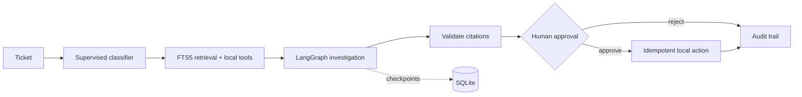
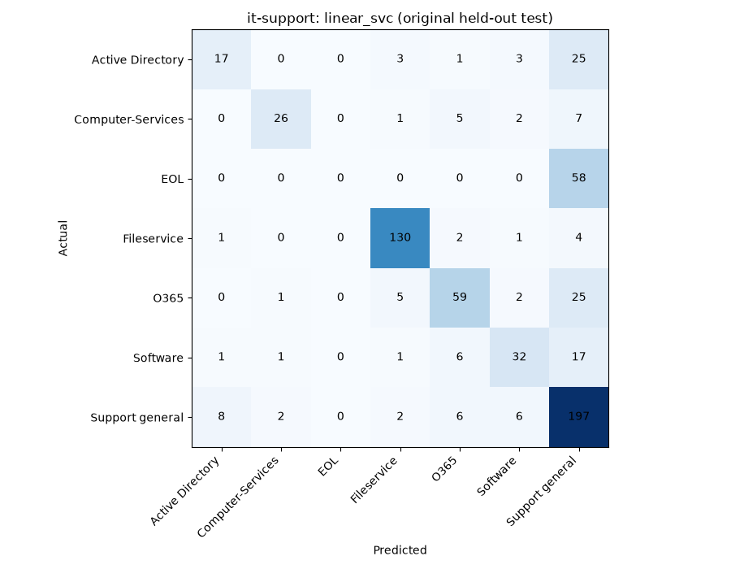

# OpsPilot — Agentic IT Incident Copilot

Investigate IT tickets with supervised classification, source-attributed lexical retrieval
and a persistent LangGraph workflow. Inspect evidence and approve or reject a proposed note
attachment. All operational actions target an original fictional local company.

Python 3.13 · uv · FastAPI · Pydantic · LangGraph · SQLite FTS5 · scikit-learn ·
Pandas · NumPy · Matplotlib · Streamlit

## Engineering features

- TF-IDF Logistic Regression / LinearSVC with grouped validation and model persistence.
- Authentic 2,229-ticket adapter, original labels/splits, revision/checksum provenance and EDA.
- 24 original synthetic runbooks, 32 tickets, 32 historical incidents and eight services.
- Content-derived chunk IDs, BM25 ranking, duplicate detection and atomic full reindex.
- Genuine conditional LangGraph execution, SQLite checkpoints and interrupt/resume.
- Durable human decisions, transactional tool authorization and idempotent actions.
- Authenticated API, interactive review dashboard and isolated reproducible evaluation.
- Offline templates clearly labeled **non-LLM**; optional opted-in live summarization.

## Architecture



CLI, API and evaluation reuse domain services. The dashboard calls the authenticated API.
See [architecture](docs/architecture.md) and [evaluation protocol](docs/evaluation.md).

## Quick start — Windows PowerShell

Install Git, uv and Python 3.13. From the repository root:

```powershell
uv sync --locked
uv run opspilot seed-demo
uv run opspilot index
uv run opspilot evaluate
uv run opspilot report
$env:OPSPILOT_API_TOKEN = (uv run python -c "import secrets; print(secrets.token_urlsafe(32))")
uv run uvicorn opspilot.api.app:app --host 127.0.0.1 --port 8000
```

In a second terminal use the same token:

```powershell
$env:OPSPILOT_API_TOKEN = '<same token as API>'
uv run streamlit run apps/dashboard.py --server.address 127.0.0.1 --server.port 8501
```

Open http://127.0.0.1:8501. Select a ticket or enter a custom incident. Inspect category,
user-reported severity, source excerpts, troubleshooting, service health and workflow nodes.
Approve/reject the pending action and inspect its audit trail. History reopens previous runs;
Evaluation displays computed metrics, dataset statistics and available confusion matrices.
The token can also be entered in the sidebar. Use localhost; this is a local application.

`seed-demo` regenerates fixtures and trains a demo classifier. `index` replaces the index,
including deletions. Runtime files live in ignored `data/runtime/` and models in `artifacts/`.
`.env.example` documents settings; `.env` is ignored. Linux/macOS use equivalent `export` commands.

## Authentic dataset and ML methodology

```powershell
uv run opspilot download-dataset --source it-support
uv run opspilot train-classifier
uv run opspilot evaluate --dataset it-support
uv run opspilot report --dataset it-support
```

Source: [Classification of IT Support Tickets](https://zenodo.org/records/7648117),
[Hugging Face mirror](https://huggingface.co/datasets/tasksource/it-support-tickets), CC BY 4.0.
The multilingual dataset has seven classification categories, **no validated resolutions or
severity labels**. Cached original Parquet splits are schema-checked, with revision, UTC download
time and SHA-256 checksums recorded. EDA reports missing values, category/length distributions,
duplicates, split balance and anonymized examples. Language detection is omitted as unreliable.

NFKC/lowercase/whitespace normalization precedes word TF-IDF (1–2 grams, 20k features).
Training quarantines normalized ticket texts also present in the original test set, without
consulting test labels. Grouped training validation selects C in {0.5, 2.0} and the model;
then the full cleaned training set is refit. The original held-out test stays unchanged.
See [evaluation.md](docs/evaluation.md) for duplicate counts and limitations.

To use the authentic classifier after training, set `OPSPILOT_CLASSIFIER_DATASET=it-support`
before starting the API. Authentic labels are preserved; fictional service lookup comes from
retrieved metadata, without an invented category mapping. Severity remains user-reported.
LinearSVC has no probability output; Logistic Regression probabilities are uncalibrated.

## Actual results

Authentic revision `e0bbdcb96c84feaa394aaae9c48f8ba4b818451b`, seed 42:
1,453 cleaned training records (119 overlapping rows quarantined), 657 original test records.
All 45 original EOL training rows are among those overlaps, leaving **zero clean EOL training
examples**. Its 58 test records remain in the seven-category metrics and matrix; EOL recall is
zero. This is an explicit limitation of the decontaminated baseline, not seven-category coverage.

| Model | Accuracy | Macro-F1 | Weighted-F1 |
|---|---:|---:|---:|
| Logistic Regression | 0.6682 | 0.5287 | 0.6240 |
| LinearSVC (validation-selected) | 0.7017 | 0.5893 | 0.6643 |



Separate **SYNTHETIC** 24-query fixture evaluation: Recall@5 1.000, MRR 1.000,
citation validity 1.000, approval enforcement 1.000, action idempotency 1.000.
These runbook-title queries are simple smoke benchmarks, not production resolution accuracy.
The perfect synthetic classifier result reflects shared template vocabulary. All JSON/CSV/Markdown
reports and charts are in `reports/real/` and `reports/synthetic/`. Measured latency varies by host.

## API usage

Swagger: http://127.0.0.1:8000/docs. `/health` is public; data endpoints require a bearer token.

```powershell
$headers = @{ Authorization = "Bearer $env:OPSPILOT_API_TOKEN" }
$body = @{ title = 'VPN certificate expired'; description = 'VPN certificate expired this morning' } | ConvertTo-Json
$run = Invoke-RestMethod -Method Post -Uri http://127.0.0.1:8000/api/v1/tickets/analyze -Headers $headers -ContentType 'application/json' -Body $body
Invoke-RestMethod -Method Post -Uri "http://127.0.0.1:8000/api/v1/investigations/$($run.id)/approve" -Headers $headers -ContentType 'application/json' -Body '{"note":"Reviewed evidence"}'
Invoke-RestMethod -Uri "http://127.0.0.1:8000/api/v1/investigations/$($run.id)/audit" -Headers $headers
```

Endpoints: `GET /health`, `GET /api/v1/tickets`, `GET /api/v1/tickets/{ticket_id}`,
`POST /api/v1/tickets/analyze`, `GET /api/v1/investigations`, `GET .../{id}`,
`POST .../{id}/approve`, `POST .../{id}/reject`, `GET .../{id}/audit`,
`GET /api/v1/evaluation/summary`. Existing `ticket_id` uses authoritative stored text;
request execution options still apply. Missing records: 404; invalid bodies: 422;
incompatible decisions: 409; invalid token: 401; missing auth configuration: 503.
Repeated identical final decisions return the stored result.

## Optional live LLM

Set `OPSPILOT_LIVE_ENABLED=true`, `OPSPILOT_LLM_MODEL`, `OPSPILOT_LLM_API_KEY`,
and an operator-controlled `OPSPILOT_LLM_BASE_URL`; submit `mode: "live"`.
One bounded-timeout OpenAI-compatible call produces schema-validated JSON. Provider text cannot
select tools or approve actions. Citation membership is validated; semantic truth still needs
human review. Default mode never makes paid calls. Live execution is mock-tested only.

## Docker

```powershell
$env:OPSPILOT_API_TOKEN = '<random local token>'
docker compose up --build
```

API 8000 and UI 8501 bind to localhost. The non-root image installs the lockfile. Compose seeds
and indexes the demo. Named `runtime` and `models` volumes preserve checkpoints, audit and models;
avoid deleting volumes when retaining history. Secrets are supplied at runtime.
Docker daemon was unavailable during initial validation; builds remain unverified.

## Tests and CI

```powershell
uv run ruff check .
uv run ruff format --check .
uv run pytest -q
uv run python tools/smoke.py
```

Tests cover dataset mocks, model persistence, retrieval, API validation, checkpoint restart,
rejection/concurrent approval, malicious documents, provider validation and the actual Streamlit
investigation/approval flow. Coverage threshold: 80% across application modules (CLI excluded).
GitHub Actions runs locked Python 3.13 installation, Ruff, pytest and offline CLI pipelines,
with no paid provider or real-data download. Remote CI success must be verified separately.

## Security, limitations and future improvements

Documents/tickets are untrusted. Tool names and mutation targets are allowlisted. No arbitrary
shell or real infrastructure execution exists. A durable decision is checked in the mutation
transaction; action and audit write commit atomically. The local bearer token is not multi-user
RBAC. There is no encrypted DB or tamper-evident audit. Load only trusted, locally created joblib
artifacts because serialization can execute code. Keep API and dashboard on localhost.

Lexical retrieval may return weak matches. Summaries use bounded templates by default. Exact
duplicates are controlled, but semantic near duplicates and multilingual generalization remain
risks. Next improvements: independently authored retrieval queries, multilingual embeddings,
calibration/abstention, semantic claim validation, multi-user identity and production storage.
No browser screenshots were captured; Streamlit's actual test runner verifies interaction.

## AI-Assisted Development

AI coding tools assisted implementation, debugging, tests and documentation. Reproducible
commands, actual benchmark artifacts and explicit engineering tradeoffs support review.
This project does not claim that every line was written manually.

## License and acknowledgements

Original code and original Northstar fixtures: [MIT](LICENSE). Third-party datasets retain their
own licenses (IT tickets: CC BY 4.0); MIT does not relicense the data. Thanks to the dataset authors
and maintainers of LangGraph, scikit-learn and the Python stack.
