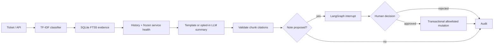

# Architecture

The CLI, API and evaluation share domain services. The dashboard calls the API.
`workflow.py` compiles a typed StateGraph with SQLite checkpoints and conditional edges.
Every resumed invocation uses the original thread ID. Repeated approval is serialized by
an investigation-specific file lock, including separate processes. SQLite `BEGIN IMMEDIATE`
and an action primary key enforce mutation idempotency. A persisted decision is checked again
at the tool boundary; graph state alone grants no permission.

Read tools: knowledge search, history, service health, ticket lookup and in-memory note drafting.
Write tools: note attachment and follow-up creation. The workflow currently proposes a note.
Follow-up creation is available through the same approved tool service, not autonomous model selection.
No tool modifies real infrastructure. Severity is explicitly user-reported, default unknown.
Authentic classification categories remain distinct from fictional service names; service lookup
comes from retrieved document metadata and is not an invented label mapping.

KB indexing replaces the full index atomically. IDs include document identity, offset and content.
Sources, metadata and FTS BM25 scores accompany every chunk. One highest-ranking chunk per
document is returned. Scores are ranking values, not confidence probabilities. No semantic model
is installed; lexical retrieval requires no downloads. Reindexing invalidates changed chunk IDs.

## Trust and deployment

All ticket and document text is untrusted. Template mode never interprets document instructions.
Live mode sends explicit untrusted data boundaries, validates JSON and citation membership,
and has no model-controlled tool execution. One provider call, configured timeout, no retries.
Live model text remains an unverified draft; it is never shell input.

All data endpoints require a local bearer token and fail closed if none is configured.
Bind both services to localhost. The token is a local-demo safeguard, not multi-user RBAC.
Do not expose the dashboard or API directly to the Internet. Joblib artifacts must be locally
created and trusted. Paths and provider base URLs are operator configuration, never caller input.
Logs contain IDs/counts only. Audit is persistent but not cryptographically tamper-proof.
SQLite and file locks suit a single local host, not distributed production deployment.
